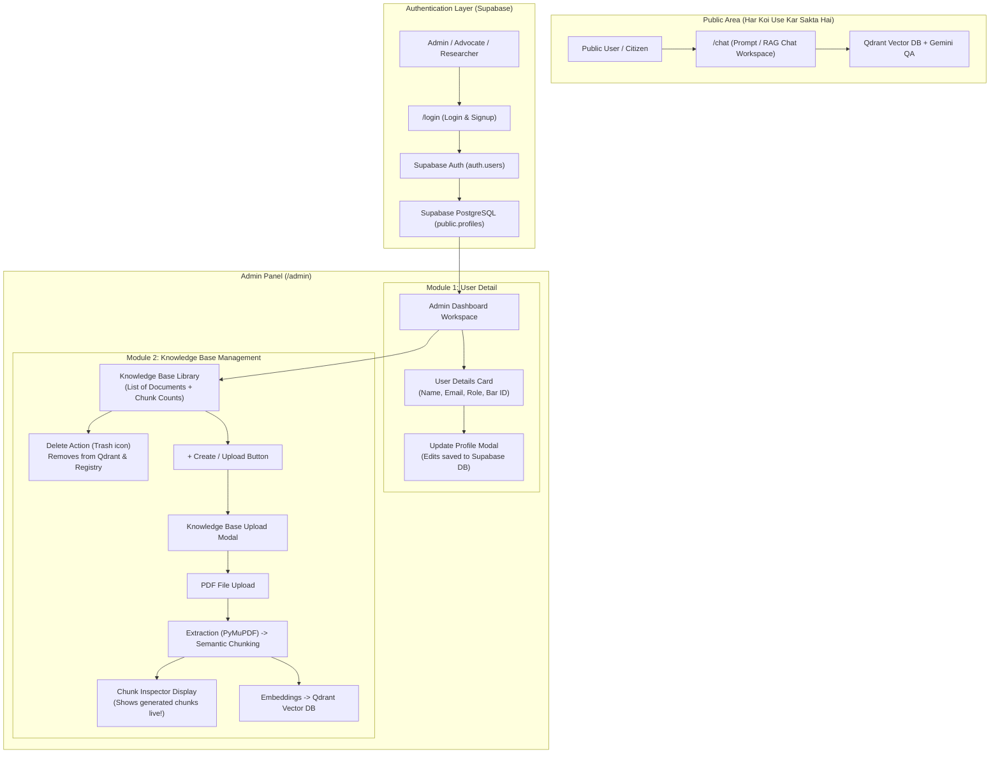
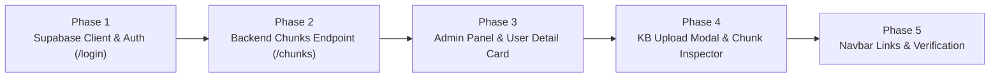

# 🏛️ LegalEase Admin Panel & Knowledge Base Implementation Plan

Based on the architectural workflow diagram from your Eraser.io whiteboard, here is the complete system design and step-by-step implementation plan.

---

## 1. System Flow & Architecture (Based on your Diagram)

---

## 2. Core Modules Breakdown

### Module A: Authentication & Supabase Schema (`/login`)
1. **Supabase Client (`web/lib/supabase.ts`)**:
   - Integrates `@supabase/supabase-js`.
   - Reads `NEXT_PUBLIC_SUPABASE_URL` and `NEXT_PUBLIC_SUPABASE_ANON_KEY`.
   - Includes seamless fallback so the UI never crashes even if keys are being configured.
2. **Supabase Database Schema (`public.profiles`)**:
   - Stores custom user profile fields linked 1:1 with `auth.users`:
     - `id` (UUID references `auth.users.id`)
     - `full_name` (Text)
     - `email` (Text)
     - `role` (Text: Advocate / High Court, Corporate Counsel, Legal Researcher, Admin)
     - `bar_license_no` (Text, optional)
     - `phone` (Text, optional)
     - `updated_at` (Timestamp)
3. **Auth Screen (`web/app/login/page.tsx`)**:
   - Sleek LegalEase glassmorphic dark-neon `#D4FF58` aesthetic.
   - Smooth toggle between **Sign In** and **Sign Up**.
   - On successful login/signup, redirects directly to `/admin`.

---

### Module B: Admin Panel Layout (`/admin`)
**File:** `web/app/admin/page.tsx`
- Modern, high-density 2-column or sidebar layout:
  - **Left Section / Sidebar: User Detail**:
    - Profile avatar badge.
    - Displays user details fetched directly from Supabase: Full Name, Email, Role, Bar Council ID, Account Created Date.
    - **Update Button**: Opens an interactive form modal where user can edit their name, phone, role, or license number, updating Supabase in real-time.
  - **Right Section: Knowledge Base**:
    - Header showing total documents, total chunks in Qdrant, and storage health.
    - **`+ Upload Document` (Create button)**.
    - **Knowledge Base Table/List**:
      - Document Title (e.g., Pakistan Penal Code, Contract Act, Custom PDF).
      - Chunk count (e.g., 60 chunks).
      - Page count.
      - Creation date.
      - Actions: **View Chunks** button & **Delete (Trash icon)** button.

---

### Module C: Knowledge Base Upload Modal & Live Chunk Inspector
**Components:** `UploadModal.tsx` & `ChunkInspectorModal.tsx`
1. Clicking **`+ Create / Upload`** opens the upload modal.
2. User drops or selects a PDF document.
3. System triggers backend ingestion (`POST /documents/index`).
4. **Live Pipeline Progress Visualizer**:
   - Step 1: Text & PyMuPDF Extraction.
   - Step 2: Semantic Chunking (Section regex & clause grouping).
   - Step 3: Vector Embeddings generation.
   - Step 4: Qdrant Indexing.
5. **Interactive Chunk Viewer ("Chunk ban k hume dikhenge")**:
   - Immediately displays all generated chunks in a dedicated card view:
     - **Chunk Badge:** e.g., `Chunk #1 • Section 1` or `Clause 2`.
     - **Metadata:** Page Number, Character Count, Source (Text / OCR).
     - **Text Preview:** Exact chunk text content.
   - Also accessible anytime by clicking "View Chunks" next to any document in the list!

---

## 3. Backend API Endpoints Required

| Method | Endpoint | Description |
| :--- | :--- | :--- |
| `POST` | `/documents/index` | Uploads PDF, extracts, chunks, embeds, and saves to Qdrant (already built; will enhance to return chunk previews). |
| `GET` | `/documents` | Returns list of all indexed user documents with chunk counts. |
| `GET` | `/documents/{doc_id}/chunks` | **[New]** Returns the actual chunk texts and metadata for a specific document so the Admin Panel can display them in the Chunk Viewer! |
| `DELETE` | `/documents/{doc_id}` | Deletes document and removes all its vector points from Qdrant. |

---

## 4. Implementation Phasing

- **Phase 1: Supabase Setup & Auth (`/login`)**:
  - Install `@supabase/supabase-js`.
  - Create `web/lib/supabase.ts` with auto-session detection.
  - Build `web/app/login/page.tsx` with Sign In / Sign Up toggles.
- **Phase 2: Backend Chunk Inspector Endpoint**:
  - Add `GET /documents/{doc_id}/chunks` in `api/main.py` so Qdrant chunks can be viewed on demand in the Admin UI.
- **Phase 3: Admin Panel (`/admin`) & User Detail**:
  - Build `web/app/admin/page.tsx`.
  - Create `UserDetailCard` with Supabase DB profile view and **Update Profile** modal.
- **Phase 4: Knowledge Base List & Chunk Viewer**:
  - Build Knowledge Base table with search and Delete action.
  - Build Upload Modal with drag-and-drop.
  - Build **Chunk Viewer** to display generated chunks with section numbers and text preview.
- **Phase 5: Navbar & Verification**:
  - Add "Admin Panel" and "Sign In / Profile" links in `MiosNavbar.tsx`.
  - Verify end-to-end flow with TypeScript compilation and browser testing.
